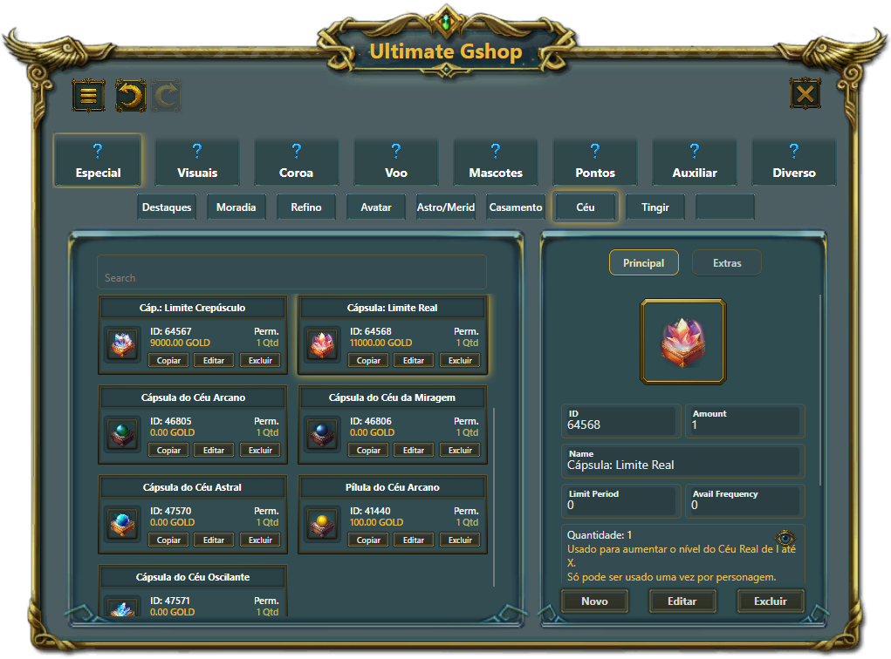

# ✨ Ultimate Gshop  
**🛒 Gshop Editor Tool for the Perfect World Game**  

  
  
  
  

Ultimate Gshop is a modern and lightweight editor for **Gshop** files used in *Perfect World*.  
✅ Fully compatible with **Gshop >= v1.7.4**.  

---

## 🚀 Main Features
- 🖊️ **Edit categories and items** with ease.  
- 🎨 **Modern UI** built with Avalonia & Fluent theme.  
- 🔍 Integrated **search and filtering**.  
- ⚡ Instant save/export to `.gshop` format.  
- 🖥️ Cross-platform ready (Windows, with Avalonia support for others).  

---

## 📸 Screenshots

### Main Window, Menu, Sales Editor

   
   
   

---

## 🛠️ Built With
- **.NET 9.0 (Windows)**  
- **Avalonia UI 11.3.3** (ColorPicker, DataGrid, ItemsRepeater, Fluent theme)  

---

## 📄 License
Licensed under the **GNU General Public License v3.0**.  
See the [LICENSE](LICENSE) file for details.  

---

💡 *Created by* **João Carlos Ilha Baierle** & **Lucas Fernando Padilha Stertz**.
