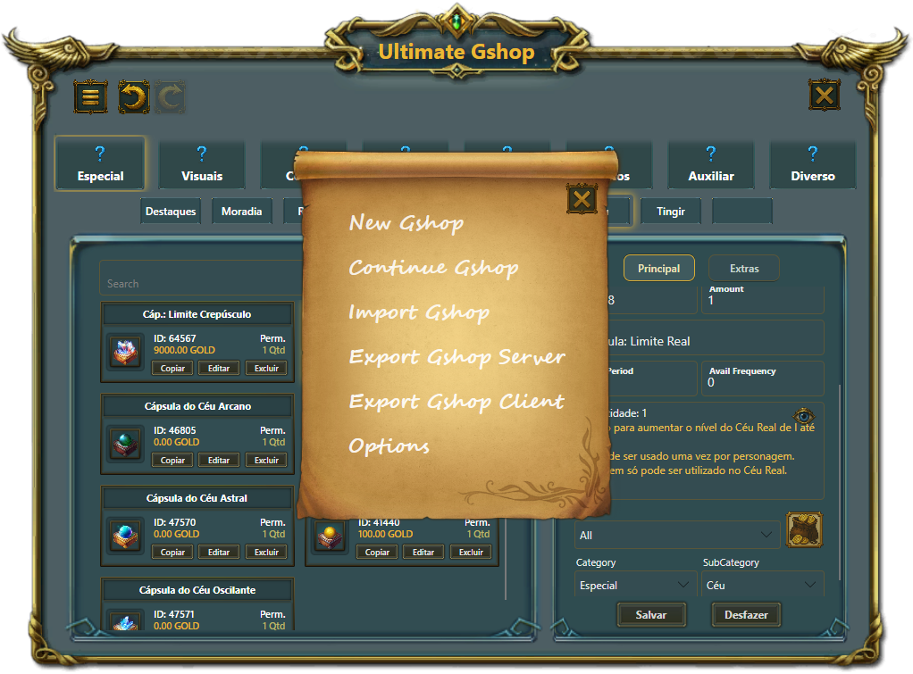
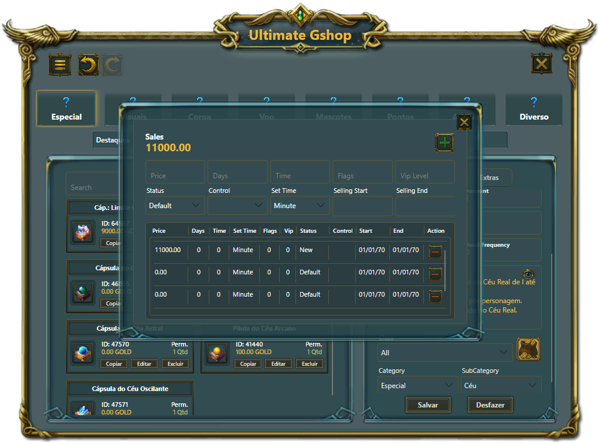

<h1 align="center">Ultimate Gshop</h1>

<p align="center">A desktop editor for Perfect World Gshop files.</p>

<p align="center">
  <a href="https://github.com/Stertz/Ultimate_Gshop/actions/workflows/ci.yml"></a>
  <a href="https://github.com/Stertz/Ultimate_Gshop/releases"></a>
  <!-- COVERAGE-BADGE:START -->
  <a href="https://github.com/Stertz/Ultimate_Gshop/actions/workflows/ci.yml"></a>
  <!-- COVERAGE-BADGE:END -->
  <!-- STACK-BADGES:START -->
  <a href="https://dotnet.microsoft.com/"></a>
  <a href="https://avaloniaui.net/"></a>
  <!-- STACK-BADGES:END -->
  <a href="LICENSE"></a>
</p>

Edit shop categories, items, sales, and gifts, then export client and server files. Ultimate Gshop is built with .NET and Avalonia for Windows, macOS, and Linux.

Help expand the [usage documentation](Docs/usage.md) and [game compatibility reports](Docs/compatibility.md) through pull requests.


## Downloads

Find preview builds in [Releases](https://github.com/Stertz/Ultimate_Gshop/releases). If no build is listed yet, use the source instructions below.

Extract the complete download before running the application. Keep its resource folders alongside the executable.

## Features

- Create shops and organize categories and subcategories.
- Edit item details, prices, sale periods, and gifts.
- Search, filter, clone items, and undo or redo changes.
- Import Gshop files and export client or server data.

<details>
<summary>More screenshots</summary>

| Menu | Sales editor |
| --- | --- |
|  |  |

</details>

## Build from source

Install the [.NET SDK](https://dotnet.microsoft.com/download) selected in [global.json](global.json), then run:

```sh
git clone https://github.com/Stertz/Ultimate_Gshop.git
cd Ultimate_Gshop
dotnet restore Ultimate_Gshop.sln
dotnet run --project Ultimate_Gshop.csproj --configuration Release --no-restore
```

## Contributing

Bug reports, feature suggestions, and pull requests are welcome. Read [CONTRIBUTING.md](CONTRIBUTING.md) for development and testing instructions.

## Credits

Created by [Lucas Fernando Padilha Stertz](https://github.com/Stertz) and [João Carlos Ilha Baierle](https://github.com/joaocib). João helped develop the original project; his contributions are preserved in the Git history.

## License

[GPL-3.0-or-later](LICENSE).
